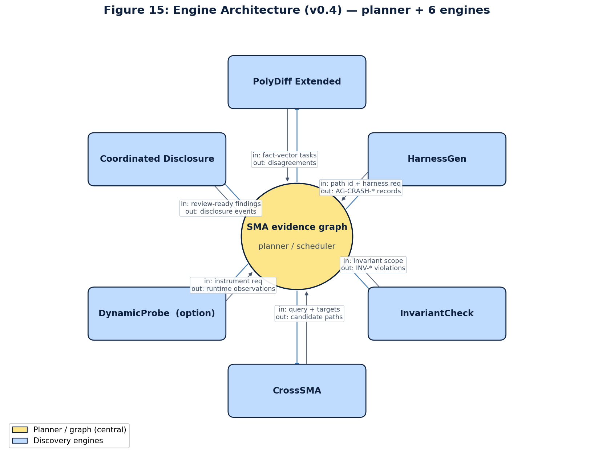

# AegisGraph — Engineering Platform

> **Graph-driven automated vulnerability discovery for secure messaging applications.** 577 Industries' engineering implementation of AegisGraph.

[](../../../LICENSE)
[](#testing)
[](#the-six-engines)
[](docs/decision-log/)
[](docs/decision-log/)



> **Looking for the public artifacts?** The sanitized public feasibility release is this project's review collection: [`review-collection/`](review-collection/). Start there if you're verifying the published AegisGraph claims.

> **Boundary inside the project:** everything outside `review-collection/` is the public/open-core engineering side. It is not the sanitized feasibility release itself; generated engineering-side evidence is excluded from that release unless it passes the export gate and human review.

---

## What This Repo Contains

The engineering platform — the actual implementation behind AegisGraph:

| Subsystem | Path | What it does |
|---|---|---|
| **PolyDiff Extended** | [`aegisgraph/polydiff/`](aegisgraph/polydiff/) | Multi-format differential parsing across 6 parser families (url, image, opengraph, deeplink, qr, proto) with normalized fact vectors |
| **HarnessGen** | [`aegisgraph/harnessgen/`](aegisgraph/harnessgen/) | Graph-driven polyglot fuzz-harness generation (Jazzer for JVM, libFuzzer+HWASAN for native, cargo-fuzz for Rust) |
| **InvariantCheck** | [`aegisgraph/invariants/`](aegisgraph/invariants/) | 15 SMA-specific security invariants with publicly-auditable ground-truth fixtures; MASTG/SSDF mapping |
| **CrossSMA** | [`aegisgraph/crosssma/`](aegisgraph/crosssma/) | Cross-application propagation matrix (4 SMA targets × 6 patterns) with structural canonicalization |
| **DynamicProbe** | not included in this repository | Frida-instrumented AOSP+HWASAN emulator with structurally-enforced signed authorization gate; a scaffold, with no live runs |
| **Coordinated Disclosure** | [`aegisgraph/disclosure/`](aegisgraph/disclosure/) | Hash-chained disclosure ledger + 7-vendor routing + day-7/14/30/60/90 embargo timer + CERT/CC fallback |
| **ReproChain** | [`reprochain/`](reprochain/) | Pre-disclosure simulation against CVE-2023-4863 (libwebp); vendored vuln+fix commits + ASAN harness |
| **Extraction** | [`extraction/`](extraction/) | Static extraction over pinned public SMAs (Signal Android, Element X Android); 8 CodeQL queries + 4 Semgrep rules + MobSF integration |
| **SMABench** | [`smabench/`](smabench/) | Three-ring benchmark design: synthetic (Ring 1), public-source static + reachability (Ring 2), authorized dynamic (Ring 3) |
| **Validator + safety** | [`validator/`](validator/), [`aegisgraph/safety.py`](aegisgraph/safety.py) | Schema validation, sanitize-check (Rules 1–9), falsifiability via deliberate-corruption test |
| **Schema** | [`schema/`](schema/) | 6 JSON schemas + Schema v2 additive extension (`discovery_run`, `crash`, `disagreement`, `invariant_violation`, `cross_target_candidate`, `disclosure_event`) |
| **Decision log** | [`docs/decision-log/`](docs/decision-log/) | 14 ADRs covering all architectural decisions |
| **Review collection** | [`review-collection/`](review-collection/) | The sanitized public release of the engine's evidence: evidence packages, the claim-evidence matrix, figures, validators and checksums |

---

## Quickstart

```bash
git clone https://github.com/577Industries/aegisgraph
cd aegisgraph
git checkout v1.0.0-tier3-research

# Recommended: use the pinned devcontainer
devcontainer up
make tooling-strict                # verify pinned toolchain
python3 -m pytest -q               # expect 1030 passed, 19 skipped

# Per-engine smoke tests
make reprochain-map                # ReproChain reachability mapping
make polydiff-regression           # PolyDiff differential parser regression (8 historical CVE rediscoveries)
make extract                       # static extraction over pinned SMAs
make smabench                      # SMABench benchmark generation
make validate                      # evidence + CETM validation
make reproduce                     # full reproduction pipeline
```

The CLI entrypoint is `aegisgraph` after installation, or `python3 -m aegisgraph.cli` from this checkout.

---

## Research Posture

- **Defensive cybersecurity research only.** No live-target probing, production account interaction, credentialed testing, or scanning without written authorization.
- **No weaponized payloads** in public artifacts (crash-triggering bytes are hash-only; raw stack traces stay engineering-side).
- **No raw target source redistribution.** We work from public source anchors (commit-pinned Signal Android and Element X Android).
- **Public artifacts gated** by `make export-public-sanitized` and explicit human approval before publication.
- **Falsifiability.** A deliberate-corruption test in the validator confirms that introducing a forbidden pattern, target-source redistribution marker, or score-vector key mismatch is caught and rejected — the discipline is testable, not just stated.

---

## Source Map + Release Boundary

The machine-readable source map is [`docs/source-map/aegisgraph-open-core-source-map.json`](docs/source-map/aegisgraph-open-core-source-map.json). It maps:

- engineering open-core tag `v1.0.0-tier3-research` / commit `d91c1df6`
- the sanitized public artifact release, v1.0.0 / commit `ac83e3f5` in the collection's original repository (`review-collection/` here descends from it; its front files have since been reworded)
- private v1.1 white-paper and slide-deck source anchors under `03_PROPOSAL/active-package/` (not part of this repository), plus its v0.4 CETM
- evidence tiers: `backed_now`, `backed_with_caveat`, and `planned_gated`

Verification commands, adapted from the source map (the source map checks out the original repository's v1.0.0 release tag for the public artifacts; here they run from `review-collection/`):

```bash
# engineering open-core checkout
git checkout v1.0.0-tier3-research
make tooling-strict
python3 -m pytest -q
make validate
make reproduce

# public sanitized artifacts, run from review-collection/
python3 scripts/verify_public_package.py
sha256sum -c checksums/SHA256SUMS

# private package (not part of this repository), run from 03_PROPOSAL/active-package/
node 05_verification/validate-evidence.mjs --version v0.4
node 05_verification/validate-cetm.mjs --version v0.4 04_evidence/v0.4/cetm.json
node --check 05_verification/validate-evidence.mjs
(cd 04_evidence/v0.4 && sha256sum -c checksums.sha256)
python3 05_verification/render-volume2.py
```

The open-core repo can be public while still excluding gated material from the sanitized release: no live probing outputs, no credentials, no raw third-party target source, and no raw crash bytes. Crash evidence remains hash-only unless a later written authorization and disclosure process explicitly changes that classification.

---

## Testing

- **1030 passing tests** at v1.0 cut (`v1.0.0-tier3-research` tag, commit `d91c1df6`)
- **19 skipped** (gated on self-hosted runner provisioning per task T-M4.1; devcontainer brings skipped count to 0)
- **CI**: `.github/workflows/ci.yml` runs on push; `reproduce.yml` is `if: false` until self-hosted runner is provisioned
- **Sanitize-check**: `validator/sanitize_check.py` enforces 9 rules across every public-export candidate before any artifact leaves this repo

---

## Decision Log

The 14 ADRs in [`docs/decision-log/`](docs/decision-log/) document every architectural decision:

| ADR | Topic |
|---|---|
| 0001 | Repo split: engineering vs public-release boundary |
| 0002 | Private ReproChain handling |
| 0003 | libwebp selection for ReproChain target |
| 0004 | PolyDiff parser selection (initial url family + extension to 6 families) |
| 0005 | Validator migration |
| 0006 | Disclosure ownership (PI named owner; counsel review gate) |
| 0007–0012 | Engine architecture (HarnessGen, InvariantCheck, CrossSMA, DynamicProbe scaffolds) |
| 0013 | Schema v2 (additive extension for engine output) |
| 0014 | Coordinated disclosure ledger format (hash-chained JSONL) |
| 0020 | PolyDiff multi-family extension |
| 0021 | Validator export discipline |

---

## Releases + Tags

- **v1.0.0-tier3-research** (current, May 2026) — full 6-engine ensemble, 1030 passing tests, Schema v2, 82-claim CETM
- **v0.3.0-tier3-research** (May 2026) — v0.3 baseline (preserved as historical anchor)

The matching public feasibility release is the review collection in [`review-collection/`](review-collection/). Its tagged releases are preserved read-only in [the collection's original repository](https://github.com/577Industries/asema-feasibility-artifacts):
- **v1.0.0** (current) — F15-F22 figure pack, 82-claim CETM, baseline-tool-delta, polydiff v1.0 schema, full traceability matrix
- **v0.3.0** — historical anchor; preserved verbatim

---

## License

Apache-2.0. See [`LICENSE`](../../../LICENSE).

## Source-of-Truth

[`SPEC.md`](SPEC.md) is the working technical specification. If implementation and spec diverge, update the spec deliberately.
