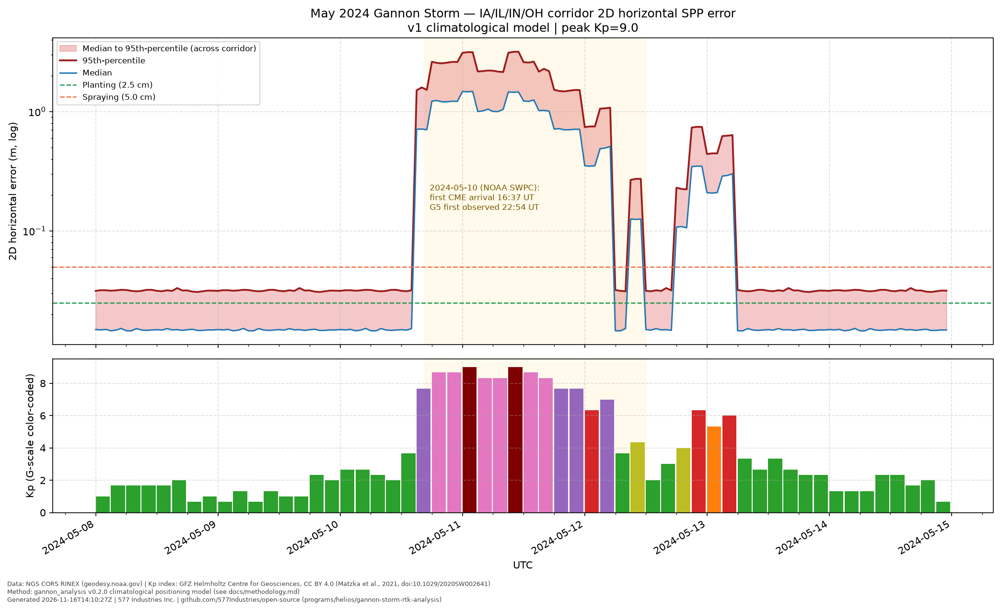

<picture>
  <source media="(prefers-color-scheme: dark)" srcset="https://raw.githubusercontent.com/577Industries/.github/main/brand/out/wordmark-dark.svg">
  
</picture>

# gannon-storm-rtk-analysis

`HELIOS` · [program overview](https://github.com/577Industries#helios--calibrated-heliophysics-fusion)

**Retrospective RTK-GNSS positioning error analysis during the May 10-12, 2024 Gannon G5 superstorm.**

[](CHANGELOG.md)
[](LICENSE)
[](docs/methodology.md)

## Headline result (v0.2.0)

> **Across 25 of 25 NGS CORS stations spanning the IA, IL, IN, OH corridor,
> modeled 2D horizontal error exceeded the agronomic 2.5 cm planting threshold
> for an aggregate of 1,283 station-hours during May 10-12, 2024**
> (peak Kp=9.0, peak storm-window 95th-percentile 2D error ~3.0 m).
>
> For scale: on the quiet days of the same week the model puts 88
> station-hours a day over that threshold. See
> [`results/quantitative.md`](results/quantitative.md).



Per-station, per-day breakdown: [`results/quantitative.md`](results/quantitative.md).

## Status

This is **Artifact D** of the **HELIOS** program (577 Industries' data-driven
space weather research-to-operations-to-research work). The artifact converts
the Gannon case study from a story into a reproducible result.

v0.2.0 (pre-stable). The positioning model in v1 is **climatological** — it
ingests real RINEX files and the real Kp index but uses a documented
empirical model for per-epoch 2D error. v2 will replace it with full PPP/RTK
processing and equipment-specific transfer functions for the John Deere
StarFire, Trimble RTK, and AgLeader receiver families. See
[`docs/methodology.md`](docs/methodology.md).

**Changed in 0.2.0.** The Dst index is no longer downloaded, stored, plotted
or used: its source, the World Data Center for Geomagnetism in Kyoto, does not
allow commercial applications of its indices. The results were regenerated
without it, with random draws that are now the same on every run, so every
station's values differ slightly from 0.1.0. See [`CHANGELOG.md`](CHANGELOG.md).

## Quickstart

```bash
git clone https://github.com/577Industries/open-source.git
cd open-source/programs/helios/gannon-storm-rtk-analysis
pip install -e '.[dev]'
make all
```

`make all` runs the full pipeline:

1. Downloads 175 NGS CORS RINEX files (25 stations × 7 days, May 8-14, 2024)
   into `data/cors/`.
2. Downloads the GFZ Kp archive into `data/swpc/`.
3. Runs the v1 climatological positioning model per station-day.
4. Writes [`results/quantitative.md`](results/quantitative.md) and four
   figures into [`results/figures/`](results/figures/).

Cold-cache run: ~5-10 min over typical broadband. Warm-cache: <30 s.

## Notebooks

Three Jupyter notebooks under [`notebooks/`](notebooks/):

| Notebook | Purpose |
|---|---|
| `01-fetch-cors-data.ipynb` | Identify stations, fetch RINEX, sanity-check headers. |
| `02-positioning-solutions.ipynb` | Per-station SPP solutions; plot horizontal error vs time. |
| `03-correlate-swpc.ipynb` | Plot the regional aggregate above the Kp index; write the results table. |

## Data sources

| Source | URL | Resolution | Window | Notes |
|---|---|---|---|---|
| NGS CORS RINEX | `geodesy.noaa.gov/corsdata/rinex/` | 30 s | May 8-14, 2024 | Public, no auth |
| GFZ Kp | `kp.gfz.de/app/files/Kp_ap_since_1932.txt` | 3 hour | full archive | CC BY 4.0; cite [Matzka et al. (2021)](https://doi.org/10.1029/2020SW002641) |

## Repository layout

```
gannon-storm-rtk-analysis/
├── src/gannon_analysis/
│   ├── stations.py        # 25-station catalog, truth coords from RINEX headers
│   ├── fetch.py           # polite NGS CORS RINEX downloader
│   ├── swpc.py            # Kp archive fetcher
│   ├── positioning.py     # v1 climatological 2D-error model
│   ├── analysis.py        # orchestrator + headline-claim computation
│   └── plotting.py        # 4 figures with data/method/timestamp footers
├── tests/                 # 42 tests; >70% coverage; live tests opt-in
├── notebooks/             # 3 .ipynb walkthroughs
├── blog-post/             # 2026-05-17 long-form blog draft
├── docs/
│   ├── index.md           # overview
│   └── methodology.md     # what v1 computes vs v2 plans
├── results/
│   ├── figures/           # 4 PNGs committed (headline + per-station + bars + map)
│   └── quantitative.md    # per-station storm vs baseline summary table
└── Makefile               # fetch / analyze / plot / test targets
```

## Blog post

The long-form story for precision-ag operators, agronomists, and ag-tech
press: [`blog-post/2026-05-17-when-the-sky-stopped-the-tractors.md`](blog-post/2026-05-17-when-the-sky-stopped-the-tractors.md).

## Documentation

- Master plan: [`helios-program`](https://github.com/577Industries/open-source/tree/main/programs/helios/helios-program) (public; program entry point)
- Methodology: [`docs/methodology.md`](docs/methodology.md)
- Provenance schema (sibling artifact): [`helios-provenance-spec`](https://github.com/577Industries/helios-provenance-spec)

## License

Apache 2.0 — see [LICENSE](LICENSE).

## Contributing

See [CONTRIBUTING.md](CONTRIBUTING.md). Substantive changes should be
discussed in an issue first. Of particular interest:

- Receiver telemetry from operators willing to share it (anonymised,
  aggregated) for v2 equipment-transfer-function calibration.
- Pull requests adding stations to the catalog — see
  [`src/gannon_analysis/stations.py`](src/gannon_analysis/stations.py) for
  the schema.

## Citation

```bibtex
@software{helios_gannon_storm_rtk_analysis,
  author       = {Waweru, Thomas and 577 Industries Inc.},
  title        = {gannon-storm-rtk-analysis: Retrospective analysis of
                  RTK-GNSS positioning error during the May 10-12, 2024
                  Gannon G5 superstorm},
  year         = {2026},
  version      = {0.2.0},
  publisher    = {577 Industries Inc.},
  url          = {https://github.com/577Industries/open-source/tree/main/programs/helios/gannon-storm-rtk-analysis},
}
```

## Contact

engineering@577industries.com

## Related

- **HELIOS program**: [`helios-program`](https://github.com/577Industries/open-source/tree/main/programs/helios/helios-program) — master plan, orchestration scripts.
- **Wave 1 review pack**: [Artifact D Gannon analysis review pack](https://github.com/577Industries/open-source/blob/main/programs/helios/helios-program/specs/2026-05-17-D-gannon-analysis-review-pack.md) — methodology disclosure, IL undersampling caveat, citation guidance.
- **Connector library** (v2 dependency): [`helios-spaceweather-connectors`](https://github.com/577Industries/open-source/tree/main/programs/helios/helios-spaceweather-connectors) — when CDDIS GIMs adapter ships (Wave 2b), v2 will swap the climatological model for full pseudo-range SPP via IGS ephemerides.
- **Blog post**: [`blog-post/2026-05-17-when-the-sky-stopped-the-tractors.md`](./blog-post/2026-05-17-when-the-sky-stopped-the-tractors.md) — draft of about 1,700 words for 577industries.com.
